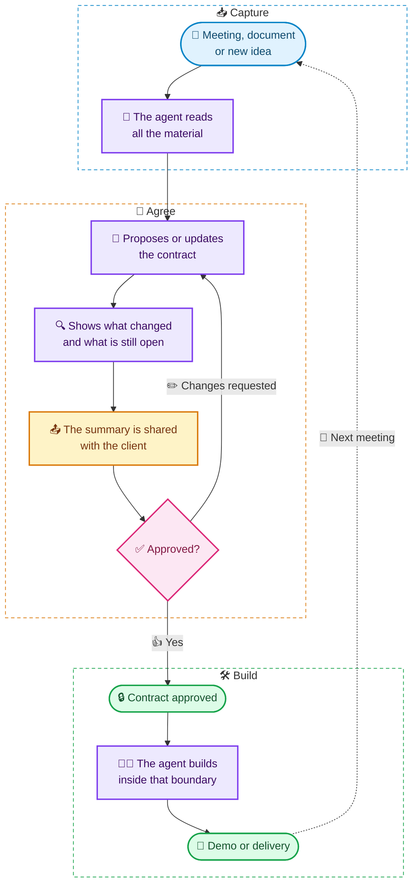

# 📜 BCDD — Business Contract Driven Development

[](https://github.com/qbitdevz/bcdd/tags)
[](LICENSE)
[](https://nodejs.org)
[](#install)
[](#use)
[](https://agentskills.io)
[](package.json)

**Get the client, the PM and the developer to understand the same thing before the agent writes any code.**

With AI agents, building is no longer the slow part. The bottleneck now is understanding what to
build and under which rules. BCDD is a skill for coding agents (Claude Code, Pi / gentle-shell, Codex,
OpenCode) that takes what you already have — meeting transcripts, documents, chats, your own ideas —
and keeps **a single file** per project, the business contract:

- 🎯 the problem, in one sentence;
- 👀 what the client will notice;
- 📏 **the business rules**, in plain language;
- 🔀 a diagram of how it works;
- 🚫 what is **out of scope**;
- 📋 the requirements and their status;
- 📝 what changed since the previous meeting.

It reads in two minutes. From then on the agent uses it as the boundary of what it may build.
The full methodology is in [English](docs/METHODOLOGY.md) and [Spanish](docs/METODOLOGIA.md).

| For | What it solves |
|---|---|
| 👤 **Client** | Confirms in two minutes that this is what they need, without reading technical documentation |
| 🧭 **PM / project lead** | Sees what is in, what is out, what changed in each meeting and what is still to decide |
| 💻 **Developer** | Gets back the map of business rules that writing the code no longer gives them |

> 🚧 **Status: version 0.3, in testing.** The installer and the tools have automated tests, run on
> Windows and Linux. Real-world validation with each agent is still pending. If something breaks,
> open an issue: that is exactly what we need to know.

> 🌐 **Language.** The contract is written in your client's language. The skill's instructions and
> the installer's messages are in Spanish.

<a id="how-it-works"></a>

## 🔀 How it works



<a id="contents"></a>

## 📑 Contents

- 🔀 [How it works](#how-it-works)
- 🚀 [Install](#install) · ⚙️ [Options](#options)
- 💬 [Use](#use)
- 🧰 [Commands](#commands)
- 🩺 [Doctor](#doctor)
- 🔄 [Update](#update)
- ✅ [Validate a contract](#validate)
- 📄 [Client page](#client-page)
- 🗑️ [Uninstall](#uninstall)
- 📂 [Files it creates](#files)
- 🔧 [Environment variables](#variables)
- 🤝 [How it works with ODD, gentle-ai and Engram](#coexistence)
- 🗂️ [Repository layout](#layout)
- 🙌 [Contributing](#contributing)

<a id="install"></a>

## 🚀 Install

One command, from the root of your project:

🍎🐧 **macOS / Linux / WSL**

```bash
curl -fsSL https://raw.githubusercontent.com/qbitdevz/bcdd/main/scripts/install.sh | sh
```

🪟 **Windows (PowerShell 5.1 or 7)**

```powershell
irm https://raw.githubusercontent.com/qbitdevz/bcdd/main/scripts/install.ps1 | iex
```

The `curl` command also works in Git Bash on Windows.

It downloads the package to `~/.bcdd/pkg` and copies the skill to `.claude/skills/bcdd/` and
`.agents/skills/bcdd/` in the project. What it writes, in detail, is in
[Files it creates](#files).

🔁 **Running the same command again updates to the latest version.**

**📦 Requirements**

| For | You need |
|---|---|
| `install.sh` | `sh`, `tar` and `curl` or `wget` |
| `install.ps1` | PowerShell 5.1 or later (Windows 10/11 ships with it) |
| Doctor, lint, client page, `AGENTS.md` rule | Node 18 or later (you already have it if you use gentle-shell or Pi) |

Without Node the skill still installs, in basic mode: it is only copied, with or without `--global`.
Any other option or command needs Node.

<a id="options"></a>

### ⚙️ Options

Pass options like this:

```bash
curl -fsSL https://raw.githubusercontent.com/qbitdevz/bcdd/main/scripts/install.sh | sh -s -- --with-rule
```

```powershell
& ([scriptblock]::Create((irm https://raw.githubusercontent.com/qbitdevz/bcdd/main/scripts/install.ps1))) --with-rule
```

In PowerShell you can also use the short form with the `BCDD_ARGS` variable:

```powershell
$env:BCDD_ARGS = '--with-rule'; irm https://raw.githubusercontent.com/qbitdevz/bcdd/main/scripts/install.ps1 | iex
```

| Option | What it does |
|---|---|
| `--with-rule` | Adds 3 lines to `AGENTS.md` (or `CLAUDE.md`, whichever the project uses) so the agent respects the contract even when you don't invoke the skill. They sit between `bcdd` markers; the rest of the file is untouched, and uninstalling leaves it exactly as it was. Once added, reinstalls keep it. |
| `--no-rule` | Removes that rule. |
| `--global` | Installs to `~/.claude/skills` and `~/.agents/skills`, for all your projects. The rule is per project, so `--global` does not add it. |
| `--target claude\|agents\|both` | Picks the folder. Both by default. If you only use OpenCode, pick one. |
| `--dir <path>` | Target project, if it is not the current directory. |
| `--force` | Overwrites a skill you edited by hand, saving a copy first. |
| `--offline` | Does not query the repository (doctor, update). |
| `--no-pull` | In `update`, does not run `git pull`. |

If you'd rather review the script before running it, download it, read it and run it by hand. You
can also clone the repository and run `node install.mjs` directly.

<a id="use"></a>

## 💬 Use

| You want to… | Do this |
|---|---|
| Start a project | Give the agent the transcript or notes and invoke the skill |
| Add it to a project in progress | Ask it to "adopt BCDD in this project" |
| Bring in a new meeting | Give it the transcript: it shows the impact and updates the contract |
| Send the summary to the client | Ask it to "share with the client": it drafts the message and, if you want, a [page ready to send or print to PDF](#client-page) |
| Record an approval | Tell it who approved; it never approves on its own |
| Know what was left out or what changed | Ask; it answers from the contract |
| Build | Approve the contract and ask for the implementation as usual |

Invocation: `/bcdd` (Claude Code, OpenCode), `/skill:bcdd` (Pi, gentle-shell), `$bcdd` (Codex). It
also activates on its own when you hand it meeting material.

The contract is saved to `bcdd/contrato.md`; the agent creates it, not the installer. Your
transcripts and documents **stay where they are**: the contract only records their paths. To adapt
the format without touching the skill, put your own `plantilla.md` (template) next to the contract.

<a id="commands"></a>

## 🧰 Commands

Once installed, the installer lives at `~/.bcdd/pkg/install.mjs`. The path is written differently
depending on the shell:

```bash
# macOS / Linux / WSL / Git Bash
node ~/.bcdd/pkg/install.mjs doctor
```

```powershell
# Windows PowerShell
node $HOME\.bcdd\pkg\install.mjs doctor
```

| Command | What it does |
|---|---|
| `install` | Installs or updates the skill. This is the default command. |
| `update` | Reinstalls only where it was already installed, with the same options. See [Update](#update). |
| `doctor` (or `check`) | Checks the installation without changing anything. |
| `lint <contract.md>` | Validates a contract. |
| `uninstall` | Removes the skill and the rule. |
| `help` | Shows the help. |
| `set-repo user/repo` | For fork maintainers only: changes the repository in the scripts, the README and `package.json`. |

They all accept the relevant [options](#options). They can also run through the install command,
without having the package: `curl … | sh -s -- doctor`, or in PowerShell
`$env:BCDD_ARGS = 'doctor'; irm … | iex`.

<a id="doctor"></a>

## 🩺 Doctor: is it installed correctly and up to date?

```bash
node ~/.bcdd/pkg/install.mjs doctor
```

Without changing anything, it checks:

- that the skill is complete and unaltered (it compares each file against what was installed);
- that the `AGENTS.md` rule is still in place, not damaged and not outdated;
- that `bcdd` appears in the gentle-ai skill registry, if the project uses it (has `.atl/`);
- that the project's contracts are valid;
- whether the repository has a newer version, and which command updates it.

It exits with code 1 when it finds a problem. Run the doctor after any `gentle-ai sync`,
`gentle-shell upgrade` or update of your tools. You can also ask the agent to run it: the doctor
ships inside the skill and works without the package:

```bash
node .claude/skills/bcdd/scripts/doctor.mjs           # or .agents/skills/bcdd/...
node .claude/skills/bcdd/scripts/doctor.mjs --json    # JSON output
```

Offline (or with `--offline`), the version check is skipped and everything else works the same.

<a id="update"></a>

## 🔄 Update

The simplest way is to **run the install command again**: it downloads the latest version and
reinstalls.

```bash
node ~/.bcdd/pkg/install.mjs update
```

`update` reinstalls **only where it was already installed** (project and/or global, the same
folders), keeping the rule if you had it. If the package is a git clone, it runs `git pull` first. If
it is not (the case with the install command), it **downloads nothing**: it reinstalls from
`~/.bcdd/pkg` and reminds you to run `curl`/`irm` again. If you edited the skill by hand, it does not
overwrite it: it warns you and asks for `--force`.

<a id="validate"></a>

## ✅ Validate a contract

```bash
node ~/.bcdd/pkg/install.mjs lint bcdd/contrato.md
node .claude/skills/bcdd/scripts/lint.mjs bcdd/contrato.md --json   # from the skill, as JSON
```

It catches rules without a source, requirements without "Listo cuando" (done when), broken
references, duplicate IDs, invalid statuses, technical jargon and missing sections. It warns when the
contract grows too large: more than 12 rules, more than 20 active requirements or more than 5
versions in Changes. It exits with code 1 on errors; warnings do not stop it. The agent runs it on its
own at the end of each pass.

<a id="client-page"></a>

## 📄 Client page

When you ask it to "share with the client", the agent can generate an HTML page ready to send or
print to PDF, without internal paths or the "Para quien construye" (for whoever builds) section. You
can also generate it yourself:

```bash
node .claude/skills/bcdd/scripts/exportar.mjs bcdd/contrato.md
node .claude/skills/bcdd/scripts/exportar.mjs bcdd/contrato.md --out delivery/client.html
```

By default it creates `contrato-cliente.html` next to the contract. The diagram is drawn with
Mermaid, which the page loads from the internet; offline it is shown as a list of steps.

<a id="uninstall"></a>

## 🗑️ Uninstall

```bash
node ~/.bcdd/pkg/install.mjs uninstall
node ~/.bcdd/pkg/install.mjs uninstall --global   # the global installation
```

It removes the skill, the `.claude/skills` and `.agents/skills` folders if they end up empty, and the
rule (if `AGENTS.md` only contained the rule, it deletes the file). Your contracts and sources are not
touched. To also delete the downloaded package, remove `~/.bcdd`.

<a id="files"></a>

## 📂 Files it creates

| Where | What | When |
|---|---|---|
| `~/.bcdd/pkg/` | The downloaded package | Install command (`curl`/`irm`) |
| `.claude/skills/bcdd/`, `.agents/skills/bcdd/` | The skill and its `.bcdd-manifest.json` (version and hash of each file, for the doctor) | Always (or under `~` with `--global`) |
| `AGENTS.md` or `CLAUDE.md` | 3 lines between `bcdd` markers | Only with `--with-rule` |
| `.atl/` | The gentle-ai skill registry, refreshed with `gentle-ai skill-registry refresh` | Only if the project already has `.atl/`; otherwise nothing is created |
| System temp folder (`bcdd-backup-…`) | A copy of the skill you edited | Only with `--force` |
| `bcdd/contrato.md` | The contract | Created by the agent when you use the skill |

<a id="variables"></a>

## 🔧 Environment variables

| Variable | Purpose | Default |
|---|---|---|
| `BCDD_REPO` | Source repository (`user/repo`), for a fork. The doctor uses it too | `qbitdevz/bcdd` |
| `BCDD_REF` | Branch or tag to download | `main` |
| `BCDD_HOME` | Folder where the package is kept | `~/.bcdd` |
| `BCDD_ARGS` | PowerShell only: options or command for `irm … \| iex` | — |
| `BCDD_TARBALL_URL` / `BCDD_ZIP_URL` | Full URL of the `.tar.gz` (sh) or `.zip` (PowerShell), instead of GitHub | — |
| `BCDD_UPDATE_URL` | URL of the `package.json` the doctor compares the version against (tests) | the repository's |

For example, to install a specific version: `curl -fsSL … | BCDD_REF=v0.3.1 sh`, or in PowerShell
`$env:BCDD_REF = 'v0.3.1'; irm … | iex`.

<a id="coexistence"></a>

## 🤝 How it works with ODD, gentle-ai and Engram

- **It comes before, not instead of.** BCDD defines what was agreed; ODD (or your workflow) decides how to build it.
- **No duplication.** Tasks, tests and evidence stay in `odd/tasks/`. The contract does not track progress.
- **It hands over references, not summaries.** Whoever builds reads the contract and the original source.
- **The rules for building travel inside the contract** (section 7), so any agent respects them.
- **It is not mandatory.** Bug fixes, refactors and technical changes do not go through BCDD.
- **Memory:** with Engram, it only saves a note with the contract's path and version.

Designed following the documentation of gentle-ai 4.x, gentle-shell 4.x and Engram 1.x, and
conforming to the Agent Skills specification and the gentle-shell skill style guide. It works without
any of those tools.

<a id="layout"></a>

## 🗂️ Repository layout

```
skills/bcdd/SKILL.md              rules and decision table for the agent
skills/bcdd/references/           usage modes and writing guide
skills/bcdd/assets/               template, full example and client message format
skills/bcdd/scripts/              lint, exportar (client page) and doctor
snippets/agents-rule.md           the optional rule for AGENTS.md
docs/METHODOLOGY.md               the methodology explained (English)
docs/METODOLOGIA.md               the methodology explained (Spanish)
scripts/install.sh                one-command install (macOS, Linux, WSL, Git Bash)
scripts/install.ps1               one-command install (Windows PowerShell)
install.mjs                       install · update · doctor · lint · uninstall · help · set-repo
tests/run.mjs                     automated tests
tests/fixtures/                   sample meetings and the expected contracts
tests/prueba-manual.md            guided walkthrough to test the skill with a real agent (Spanish)
tests/simulacion/                 simulated project (Adopt mode) and the contract it produced
CHANGELOG.md                      changes per version
package.json · LICENSE            package metadata and MIT license
```

<a id="contributing"></a>

## 🙌 Contributing

Try it on a real project and tell us what happened: what the agent understood well, what it didn't,
and whether your client understood the contract. [`tests/prueba-manual.md`](tests/prueba-manual.md)
has a guided walkthrough (in Spanish).

Automated tests: `node tests/run.mjs` (or `npm test`). The `curl | sh` tests run only on macOS and
Linux. MIT license.
