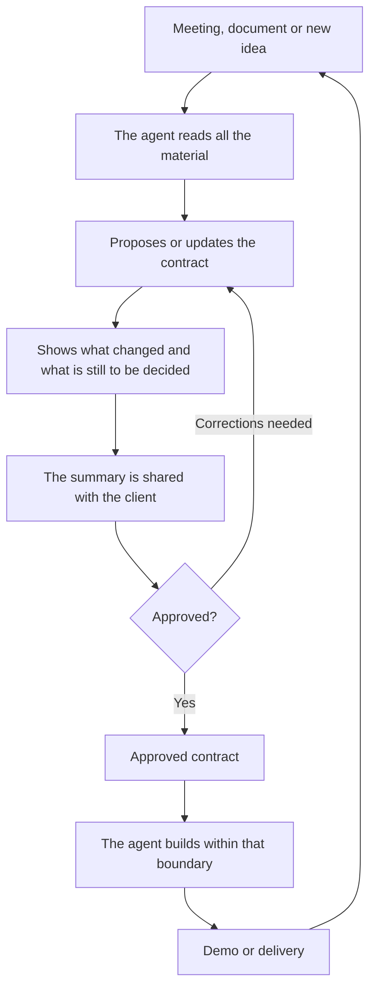

# BCDD Methodology

**English** · [Español](METODOLOGIA.md)

**Business Contract Driven Development** · version 0.3

> Make sure the client, the PM and the developer understand the same thing before the agent writes code.

---

## 1. The problem

With AI agents, building is no longer the slow part. An application or a module ships in a week or
two. What now slows projects down and makes them fail is something else: **understanding what has to
be built and under which rules**. That is the bottleneck.

It shows up in three places:

| Who | What happens to them |
|---|---|
| **Client** | Asks for something in a meeting and gets something else in the demo. They have neither the time nor the profile to read technical documentation, and often don't fully know what they want until they see it written down. |
| **PM / whoever leads** | Every meeting changes something. There is no place that says what is agreed today, what was left out and what changed since last week. |
| **Developer** | Since they no longer write the code line by line, they lose the map of the business rules. It is hard for them to validate whether what the agent produced is correct. |

The methodologies for working with agents solve *how to build* well: plan, test, review. None of them
produces something a client can read and approve. That is the gap BCDD fills.

## 2. The idea in one sentence

Before building, the agent turns everything that was discussed into **a two-minute document** that all
three read, correct and approve. That document is the business contract, and it becomes the boundary
of what the agent may build.

It is not a legal contract. It is the agreement on what will be done, written so that nobody has to
interpret it.

## 3. Principles

1. **One file per project.** If you have to search in several places, nobody reads it.
2. **All three understand it.** No frameworks, tables or endpoints. If only one person understands a sentence, it is badly written.
3. **Business rules in plain sight.** One per line, with their numbers and limits, and with their origin.
4. **What stays out gets written down.** It is what avoids the most arguments.
5. **Every meeting leaves a trail.** You can see what changed and why.
6. **The agent proposes, people approve.**
7. **Nothing is made up.** What was not defined goes in as an open question, with an owner.
8. **Zero bureaucracy.** It creates no new steps: it organizes one that is already done by hand. If
   there is no client and no scope change, it is not used.

## 4. The contract

A Markdown file, normally `bcdd/contrato.md`, written in the client's language, with seven parts:

| Part | What it contains | Who it matters most to |
|---|---|---|
| **1. In two minutes** | The problem in one sentence, 3 to 5 results the client will notice, what is out of scope, open questions | Client |
| **2. How it works** | A diagram of the process in the client's words | All three |
| **3. Business rules** | "When X happens, Y occurs". Limits, permissions, exceptions. Each with a status and an origin | Developer and client |
| **4. Requirements** | What is needed, status, what changed, when it is considered done, which rules it applies, where it came from | PM and developer |
| **5. Changes** | What was added, modified or discarded in each meeting | PM |
| **6. Sources** | Where the original material is and what could not be read | Developer |
| **7. Para quien construye** (For whoever builds) | The six rules that any agent or person follows when implementing | Developer |

### Statuses

| Requirement | Rule | Meaning |
|---|---|---|
| **A confirmar** (To be confirmed) | **A confirmar** | Proposed or deduced; still has to be validated with the client. It is not built. |
| **Acordado** (Agreed) | **Acordada** (Agreed) | Confirmed. It can be built. |
| **Entregado** (Delivered) | — | A person confirmed that it is delivered. |
| **Descartado** (Discarded) | **Descartada** (Discarded) | It was discussed and it is not going in. |

The contract does not track build progress: that lives in the development flow. That way there are no
two places that could contradict each other.

The contract itself has two statuses, **borrador** (draft) and **aprobado** (approved), and it records
separately the approval of whoever leads the project and that of the client. Any change sends it back
to draft.

Changes are marked with the values **Nuevo** (New), **Modificado** (Modified), **Sin cambios**
(Unchanged) and **Eliminado** (Removed).

### Where each thing comes from

Every rule and every requirement states its origin:

- a file with a date or a minute mark, and optionally a short quote to locate the passage;
- **equipo** (team), if it was proposed by whoever leads or develops;
- **código** (code), if it was deduced from a system that already existed.

What the team proposes goes in as "A confirmar" until the client validates it. It is common for the
client not to know exactly what they want and to adopt the proposal: the contract keeps a record that
they accepted it.

### How to write a good business rule

| Bad | Good |
|---|---|
| "The system validates credit" | "When an order makes the buyer exceed their limit, it is held until the manager approves it" |
| "Role-based permission handling" | "Each salesperson sees only their own buyers" |
| "Configurable discounts" | "The maximum discount without authorization is 10%; above that, the manager authorizes it" |

### How to write a good "Listo cuando" (done when)

It has to be verifiable. "Works well" or "validated in demo" will not do. "The manager receives a
notification when an order exceeds the limit" will: anyone can verify it, and the agent can turn it
into an automated test.

## 5. The flow

### Moments of use

| Moment | What happens |
|---|---|
| **Start** | New project. The agent drafts the first version from the initial material. |
| **Adopt** | Project already started or finished. The agent reconstructs the contract from whatever material exists, the code and the history. |
| **Update** | There was a meeting or a change. The agent compares against the current contract, shows the impact and updates it. |
| **Query** | Someone asks what is in, what is out, or what changed. It is answered from the contract. |
| **Share** | The client version is generated: a short message for WhatsApp or email, and if needed a page to send or print to PDF. No paths or internal details. |
| **Approve** | A person approves, or the client's answer arrives. The agent records it; it never approves on its own. |
| **Build** | BCDD does not build: it hands the boundary and the sources to the development flow. |

### When adopting a project already in progress

- The code shows **what the system does**, not **what was agreed**. Anything without a meeting to back
  it up stays "A confirmar".
- What was discarded in old meetings cannot be deduced from the code; it has to be supplied.
- The contract warns at the top that it is a reconstruction and which sources it was built from.
- The biggest value is that it writes down business rules that until then lived only in the code.

## 6. Where the information comes from

**Input material:** transcripts, meeting minutes, client documents, chats, and also what whoever leads
the project proposes. It does not need to be moved or organized in any particular way: the agent finds
it, asks once if something is missing and notes the paths in the contract. Audio has to be transcribed
first.

The content of that material is treated as information, never as instructions for the agent.

**Two things are used when building:**

| Source | What for | What authority it has |
|---|---|---|
| **The contract** | What gets built, what doesn't, when it is done | Defines the boundary |
| **The original material** | The detail: edge cases, examples, vocabulary | Clarifies what is already inside the boundary |

**If they contradict each other:**

- The material says something the contract excludes → the contract wins.
- The material adds a detail within an agreed requirement → it is implemented.
- The material contradicts a "Listo cuando" or a rule → stop and ask. It is a sign that the contract
  is wrong or outdated, and it is fixed before continuing.

## 7. Who does what

| Role | Does | Does not |
|---|---|---|
| **Client** | Reads the summary, confirms or corrects, answers the open questions | Read technical documentation |
| **PM / whoever leads** | Runs every meeting through BCDD, reviews the impact, approves, shares with the client | Write the contract by hand |
| **Developer** | Consults rules and requirements, validates what was built against the contract | Reconstruct the scope from memory |
| **Agent** | Reads, drafts, compares, flags contradictions and questions, validates the format | Approve, invent rules, build outside the boundary |

## 8. How it coexists with everything else

BCDD is the stage before. It replaces no development tool.

| With | Relationship |
|---|---|
| **ODD (gentle-ai / gentle-shell)** | ODD starts when it is already known what to build; BCDD is what tells it. Tasks, tests and evidence stay in `odd/tasks/`. |
| **Test-first** | Every "Listo cuando" and every business rule is a requested rule that the agent turns into a test. |
| **Review (RDD)** | Unchanged. The review operates on the code, not on the contract. |
| **Engram** | Only a note with the contract's path and version is saved. Transcripts do not go into memory. |
| **AGENTS.md / CLAUDE.md** | Not modified, unless you choose to add a three-line rule, delimited and removable. |

Coexistence rules:

- The skill writes only in the contract folder.
- The installer writes only in the skill folders (`.claude/skills/bcdd/`,
  `.agents/skills/bcdd/`) and, if you ask for it, in the `AGENTS.md` / `CLAUDE.md` rule. If the
  project already uses the gentle-ai skill registry (`.atl/`), it asks gentle-ai to update it; if not,
  it creates nothing else.
- It uses its own folders and names; it does not edit files managed by other tools.
- It hands references (paths), not summaries, to whoever builds.
- The rules for building travel inside the contract, so any agent respects them even if it doesn't
  have the skill loaded.
- It works with Claude Code, Pi / gentle-shell, Codex and OpenCode, with or without gentle-ai.

## 9. Large projects

When a contract exceeds about 20 active requirements, or there are clearly independent modules, it is
split: a general index and one contract per module. The old material (old versions, requirements
already delivered) moves to a separate history, so the main file can still be read in two minutes.

## 10. When to use it and when not to

| Use | Don't use |
|---|---|
| There was a meeting with the client | Bugfix |
| The client asked for, changed or discarded something | Refactor or internal technical improvement |
| A new project or module starts | Configuration or tooling changes |
| You join a project in progress and nobody is clear on the scope | Projects with no third parties and no scope to agree on |
| Someone asks "was this included?" | |

## 11. Common mistakes

| Mistake | Consequence | How to avoid it |
|---|---|---|
| Not running a meeting through BCDD | The agent builds against an outdated contract | Make it a habit: meeting → BCDD, the same day |
| Leaving "out of scope" empty | What was discarded comes back | Always ask what was discussed and doesn't go in |
| Writing technical jargon | The client stops reading | Reread it as if you were the client |
| Vague rules | Everyone understands something different | Concrete numbers, limits and owners |
| Not sharing it with the client | Validation only arrives at the demo | Use the Share mode after every change |
| Using it for everything | It becomes bureaucracy and gets abandoned | Only when there is a client or a scope change |
| Building with the contract in draft | Work happens on something unvalidated | Approve before implementing |
| Storing sensitive transcripts in a shared repo | Client data gets exposed | Keep them out of git or in an ignored path |

## 12. How to tell if it works

Three signals, measurable within two or three iterations:

1. **Fewer surprises at the demo.** How many times the client says "that's not what I asked for".
2. **Changes caught before building.** How many contradictions or questions showed up in the contract
   and not in the code.
3. **It gets used without anyone requiring it.** If the team skips it, it is superfluous; if they
   consult it on their own, it is useful.

## 13. Glossary

| Term | Meaning |
|---|---|
| **Business contract** | The single file with what was agreed for the project |
| **Business rule (RN)** | A business condition the system must respect |
| **Requirement (REQ)** | Something the business needs the system to do |
| **Open question (P)** | A pending decision, with who makes it and what it blocks |
| **Out of scope** | What was discussed and does not go into this stage |
| **Listo cuando** (Done when) | The verifiable condition that marks a requirement as fulfilled |
| **Source** | The original material a requirement or a rule came from |
| **Impact** | The list of changes a new meeting produces on the contract |
| **Adopt** | Bringing BCDD into a project that was already underway |
| **Share** | Generating the version of the contract to send to the client |

---

Installation, doctor and updating: see `README.md`. Template and full example of the contract:
`skills/bcdd/assets/`.
