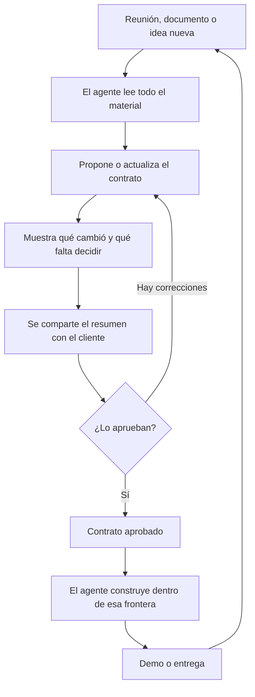

# Metodología BCDD

**Business Contract Driven Development** · versión 0.3

> Que el cliente, el PM y el desarrollador entiendan lo mismo antes de que el agente escriba código.

---

## 1. El problema

Con agentes de IA, construir dejó de ser lo lento. Una aplicación o un módulo sale en una o dos
semanas. Lo que ahora frena y hace fallar los proyectos es otra cosa: **entender qué hay que construir
y bajo qué reglas**. Ese es el cuello de botella.

Aparece en tres lugares:

| Quién | Qué le pasa |
|---|---|
| **Cliente** | Pide algo en una reunión y recibe otra cosa en la demo. No tiene tiempo ni perfil para leer documentación técnica, y muchas veces no termina de saber qué quiere hasta que lo ve escrito. |
| **PM / quien dirige** | Cada reunión cambia algo. No hay un lugar que diga qué está acordado hoy, qué quedó afuera y qué cambió respecto de la semana pasada. |
| **Desarrollador** | Como ya no escribe el código línea por línea, pierde el mapa de las reglas de negocio. Le cuesta validar si lo que hizo el agente es lo correcto. |

Las metodologías para trabajar con agentes resuelven bien el *cómo construir*: planificar, probar,
revisar. Ninguna produce algo que un cliente pueda leer y aprobar. Ese es el hueco que cubre BCDD.

## 2. La idea en una frase

Antes de construir, el agente convierte todo lo conversado en **un documento de dos minutos** que los
tres leen, corrigen y aprueban. Ese documento es el contrato de negocio, y pasa a ser la frontera de lo
que el agente puede construir.

No es un contrato legal. Es el acuerdo de qué se va a hacer, escrito para que nadie tenga que
interpretarlo.

## 3. Principios

1. **Un solo archivo por proyecto.** Si hay que buscar en varios lugares, nadie lo lee.
2. **Lo entienden los tres.** Sin frameworks, tablas ni endpoints. Si una frase la entiende solo uno, está mal escrita.
3. **Las reglas de negocio a la vista.** Una por línea, con sus números y límites, y con su origen.
4. **Lo que queda afuera se escribe.** Es lo que más discusiones evita.
5. **Cada reunión deja un rastro.** Se ve qué cambió y por qué.
6. **El agente propone, las personas aprueban.**
7. **No se inventa.** Lo que no se definió va como pregunta abierta, con responsable.
8. **Cero burocracia.** No crea pasos nuevos: ordena uno que ya se hace a mano. Si no hay cliente ni
   cambio de alcance, no se usa.

## 4. El contrato

Un archivo Markdown, normalmente `bcdd/contrato.md`, con siete partes:

| Parte | Qué contiene | Para quién es clave |
|---|---|---|
| **1. En dos minutos** | El problema en una frase, 3 a 5 resultados que el cliente va a notar, lo que queda fuera de alcance, preguntas abiertas | Cliente |
| **2. Cómo funciona** | Un diagrama del proceso con palabras del cliente | Los tres |
| **3. Reglas del negocio** | "Cuando pasa X, ocurre Y". Límites, permisos, excepciones. Cada una con estado y origen | Desarrollador y cliente |
| **4. Requisitos** | Qué se necesita, estado, qué cambió, cuándo se considera listo, qué reglas aplica, de dónde salió | PM y desarrollador |
| **5. Cambios** | Qué se agregó, modificó o descartó en cada reunión | PM |
| **6. Fuentes** | Dónde está el material original y qué no se pudo leer | Desarrollador |
| **7. Para quien construye** | Las seis reglas que cualquier agente o persona respeta al implementar | Desarrollador |

### Estados

| Requisito | Regla | Significa |
|---|---|---|
| **A confirmar** | **A confirmar** | Propuesto o deducido; falta validarlo con el cliente. No se construye. |
| **Acordado** | **Acordada** | Confirmado. Se puede construir. |
| **Entregado** | — | Una persona confirmó que está entregado. |
| **Descartado** | **Descartada** | Se conversó y no va. |

El contrato no sigue el avance de la construcción: eso vive en el flujo de desarrollo. Así no hay dos
lugares que puedan contradecirse.

El contrato en sí tiene dos estados, **borrador** y **aprobado**, y registra por separado la
aprobación de quien dirige el proyecto y la del cliente. Cualquier cambio lo devuelve a borrador.

### De dónde sale cada cosa

Cada regla y cada requisito indica su origen:

- un archivo con fecha o minuto, y opcionalmente una cita breve para encontrar el pasaje;
- **equipo**, si lo propuso quien dirige o desarrolla;
- **código**, si se dedujo de un sistema que ya existía.

Lo que propone el equipo entra como "A confirmar" hasta que el cliente lo valide. Es habitual que el
cliente no sepa bien qué quiere y adopte la propuesta: el contrato deja registro de que la aceptó.

### Cómo se escribe una buena regla de negocio

| Mal | Bien |
|---|---|
| "El sistema valida el crédito" | "Cuando un pedido hace que el comprador supere su límite, queda frenado hasta que el encargado lo aprueba" |
| "Manejo de permisos por rol" | "Cada vendedor ve únicamente a sus propios compradores" |
| "Descuentos configurables" | "El descuento máximo sin autorización es 10 %; por encima lo autoriza el gerente" |

### Cómo se escribe un buen "listo cuando"

Tiene que poder comprobarse. "Funciona bien" o "validado en demo" no sirven. "El encargado recibe un
aviso cuando un pedido supera el límite" sí: cualquiera puede verificarlo, y el agente puede
convertirlo en una prueba automática.

## 5. El flujo

### Momentos de uso

| Momento | Qué pasa |
|---|---|
| **Iniciar** | Proyecto nuevo. El agente arma la primera versión a partir del material inicial. |
| **Adoptar** | Proyecto ya empezado o terminado. El agente reconstruye el contrato con el material que haya, el código y el historial. |
| **Actualizar** | Hubo una reunión o un cambio. El agente compara contra el contrato vigente, muestra el impacto y lo actualiza. |
| **Consultar** | Alguien pregunta qué entra, qué no, o qué cambió. Se responde desde el contrato. |
| **Compartir** | Se genera la versión para el cliente: un mensaje corto para WhatsApp o mail, y si hace falta una página para enviar o imprimir a PDF. Sin rutas ni detalles internos. |
| **Aprobar** | Una persona aprueba, o llega la respuesta del cliente. El agente lo registra; nunca aprueba solo. |
| **Construir** | BCDD no construye: entrega la frontera y las fuentes al flujo de desarrollo. |

### Al adoptar un proyecto en curso

- El código muestra **qué hace** el sistema, no **qué se acordó**. Lo que no tiene una reunión que lo
  respalde queda "A confirmar".
- Lo descartado en reuniones viejas no se puede deducir del código; hay que aportarlo.
- El contrato avisa arriba que es una reconstrucción y con qué fuentes se hizo.
- El mayor valor es que deja escritas reglas de negocio que hasta ese momento solo vivían en el código.

## 6. De dónde sale la información

**Material de entrada:** transcripciones, actas, documentos del cliente, chats, y también lo que
propone quien dirige el proyecto. No hace falta moverlo ni ordenarlo de una forma particular: el
agente lo busca, pregunta una vez si falta algo y anota las rutas en el contrato. Los audios hay que
transcribirlos antes.

El contenido de ese material se trata como información, nunca como instrucciones para el agente.

**Al construir se usan dos cosas:**

| Fuente | Para qué | Qué autoridad tiene |
|---|---|---|
| **El contrato** | Qué se construye, qué no, cuándo está listo | Define la frontera |
| **El material original** | El detalle: casos borde, ejemplos, vocabulario | Aclara lo que ya está dentro de la frontera |

**Si se contradicen:**

- El material dice algo que el contrato excluye → gana el contrato.
- El material agrega un detalle dentro de un requisito acordado → se implementa.
- El material contradice un "listo cuando" o una regla → se frena y se pregunta. Es señal de que el
  contrato quedó mal o viejo, y se corrige antes de seguir.

## 7. Quién hace qué

| Rol | Hace | No hace |
|---|---|---|
| **Cliente** | Lee el resumen, confirma o corrige, responde las preguntas abiertas | Leer documentación técnica |
| **PM / quien dirige** | Pasa cada reunión por BCDD, revisa el impacto, aprueba, comparte con el cliente | Redactar el contrato a mano |
| **Desarrollador** | Consulta reglas y requisitos, valida lo construido contra el contrato | Reconstruir el alcance de memoria |
| **Agente** | Lee, redacta, compara, señala contradicciones y preguntas, valida el formato | Aprobar, inventar reglas, construir fuera de la frontera |

## 8. Cómo convive con el resto

BCDD es la etapa previa. No reemplaza ninguna herramienta de desarrollo.

| Con | Relación |
|---|---|
| **ODD (gentle-ai / gentle-shell)** | ODD arranca cuando ya se sabe qué construir; BCDD es lo que se lo dice. Las tareas, pruebas y evidencia siguen en `odd/tasks/`. |
| **Test-first** | Cada "listo cuando" y cada regla de negocio es una regla pedida que el agente convierte en prueba. |
| **Revisión (RDD)** | Sin cambios. La revisión opera sobre el código, no sobre el contrato. |
| **Engram** | Solo se guarda una nota con la ruta y la versión del contrato. Las transcripciones no van a memoria. |
| **AGENTS.md / CLAUDE.md** | No se modifican, salvo que elijas agregar una regla de tres líneas, delimitada y removible. |

Reglas de convivencia:

- La skill escribe únicamente en la carpeta del contrato.
- El instalador escribe solo en las carpetas de la skill (`.claude/skills/bcdd/`,
  `.agents/skills/bcdd/`) y, si lo pedís, en la regla de `AGENTS.md` / `CLAUDE.md`. Si el proyecto
  ya usa el registro de skills de gentle-ai (`.atl/`), le pide a gentle-ai que lo actualice; si no,
  no crea nada más.
- Usa carpetas y nombres propios; no edita archivos gestionados por otras herramientas.
- Entrega referencias (rutas), no resúmenes, a quien construye.
- Las reglas para construir viajan dentro del contrato, así las respeta cualquier agente aunque no
  tenga la skill cargada.
- Funciona con Claude Code, Pi / gentle-shell, Codex y OpenCode, con o sin gentle-ai.

## 9. Proyectos grandes

Cuando un contrato supera unos 20 requisitos activos, o hay módulos claramente independientes, se
divide: un índice general y un contrato por módulo. Lo viejo (versiones antiguas, requisitos ya
entregados) pasa a un historial aparte, para que el archivo principal siga leyéndose en dos minutos.

## 10. Cuándo usarla y cuándo no

| Usar | No usar |
|---|---|
| Hubo una reunión con el cliente | Bugfix |
| El cliente pidió, cambió o descartó algo | Refactor o mejora técnica interna |
| Arranca un proyecto o módulo nuevo | Cambios de configuración o herramientas |
| Te sumás a un proyecto en curso y nadie tiene claro el alcance | Proyectos sin terceros ni alcance que acordar |
| Alguien pregunta "¿esto estaba incluido?" | |

## 11. Errores comunes

| Error | Consecuencia | Cómo evitarlo |
|---|---|---|
| No pasar una reunión por BCDD | El agente construye contra un contrato viejo | Hacerlo hábito: reunión → BCDD, el mismo día |
| Dejar "fuera de alcance" vacío | Lo descartado vuelve a aparecer | Preguntar siempre qué se conversó y no entra |
| Escribir jerga técnica | El cliente deja de leer | Releer como si fueras el cliente |
| Reglas vagas | Cada uno entiende otra cosa | Números, límites y responsables concretos |
| No compartirlo con el cliente | La validación llega recién en la demo | Usar el modo Compartir después de cada cambio |
| Usarlo para todo | Se vuelve burocracia y se abandona | Solo cuando hay cliente o cambio de alcance |
| Construir con el contrato en borrador | Se trabaja sobre algo no validado | Aprobar antes de implementar |
| Guardar transcripciones sensibles en un repo compartido | Se exponen datos del cliente | Mantenerlas fuera de git o en una ruta ignorada |

## 12. Cómo saber si funciona

Tres señales, medibles en dos o tres iteraciones:

1. **Menos sorpresas en la demo.** Cuántas veces el cliente dice "eso no es lo que pedí".
2. **Cambios atajados antes de construir.** Cuántas contradicciones o preguntas aparecieron en el
   contrato y no en el código.
3. **Se usa sin que nadie lo exija.** Si el equipo lo saltea, sobra; si lo consulta solo, sirve.

## 13. Glosario

| Término | Significado |
|---|---|
| **Contrato de negocio** | El archivo único con lo acordado para el proyecto |
| **Regla de negocio (RN)** | Una condición del negocio que el sistema debe respetar |
| **Requisito (REQ)** | Algo que el negocio necesita que el sistema haga |
| **Pregunta abierta (P)** | Una decisión pendiente, con quién la toma y qué frena |
| **Fuera de alcance** | Lo conversado que no entra en esta etapa |
| **Listo cuando** | La condición comprobable que da un requisito por cumplido |
| **Fuente** | El material original del que salió un requisito o una regla |
| **Impacto** | La lista de cambios que una reunión nueva produce sobre el contrato |
| **Adoptar** | Incorporar BCDD a un proyecto que ya estaba en marcha |
| **Compartir** | Generar la versión del contrato para enviarle al cliente |

---

Instalación, doctor y actualización: ver `README.md`. Plantilla y ejemplo completo del contrato:
`skills/bcdd/assets/`.
