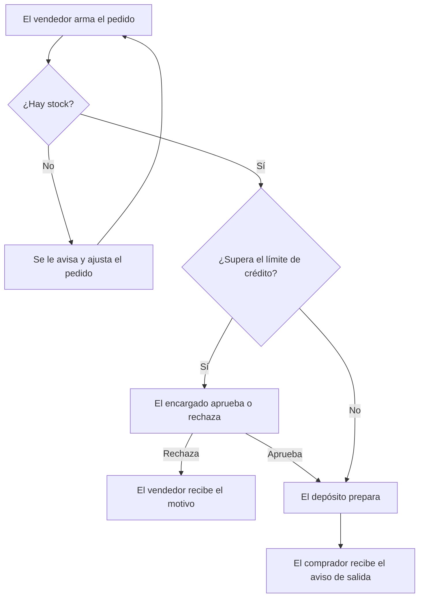

# Contrato de negocio — Pedidos Distribuidora Norte

## 1. En dos minutos

**Problema que resolvemos:** Los vendedores toman pedidos por WhatsApp y el depósito los vuelve a cargar a mano, lo que genera errores y un día de demora.

**Qué va a notar el cliente:**
- **Pedidos sin recargar:** el vendedor arma el pedido desde el celular y llega directo al depósito.
- **Stock a la vista:** el vendedor ve si hay mercadería antes de prometerla.
- **Control de crédito:** los pedidos que superan el límite del comprador esperan la aprobación del encargado.
- **Aviso al comprador:** recibe un mensaje cuando su pedido sale.

**Fuera de alcance:**
- Facturación electrónica — se sigue haciendo en el sistema actual.
- Ruteo de camiones — postergado para una segunda etapa.
- Aplicación para compradores — descartada; el pedido lo carga siempre el vendedor.

**Preguntas abiertas:**
- **P-01:** ¿Quién aprueba los pedidos cuando el encargado está de vacaciones? — responde: Distribuidora Norte — frena: REQ-03
- **P-02:** ¿Cuánto tiempo puede quedar un pedido esperando aprobación? — responde: Distribuidora Norte — frena: RN-07

## 2. Cómo funciona

## 3. Reglas del negocio

| ID | Regla | Estado | Fuente |
|---|---|---|---|
| RN-01 | Cada comprador tiene un límite de crédito que fija administración. | Acordada | docs/reuniones/2026-03-03-inicio.md · min 12 · «cada cliente tiene su tope» |
| RN-02 | Cuando un pedido hace que el comprador supere su límite, queda frenado hasta que el encargado lo aprueba o lo rechaza. | Acordada | docs/reuniones/2026-03-17-seguimiento.md · min 8 · «que no salga sin mi OK» |
| RN-03 | Si el encargado rechaza un pedido, tiene que indicar el motivo y el vendedor lo recibe. | Acordada | docs/reuniones/2026-03-17-seguimiento.md · min 10 |
| RN-04 | No se puede pedir más cantidad que el stock disponible; no hay pedidos a futuro. | Acordada | docs/reuniones/2026-03-03-inicio.md · min 20 |
| RN-05 | Solo los vendedores cargan pedidos, y cada uno ve únicamente a sus propios compradores. | Acordada | docs/reuniones/2026-03-03-inicio.md · min 25 |
| RN-06 | Un pedido ya despachado no se modifica; se corrige con un pedido nuevo. | A confirmar | equipo |
| RN-07 | Plazo máximo para que el encargado responda una aprobación: a definir. | A confirmar | docs/reuniones/2026-03-17-seguimiento.md · min 14 |

## 4. Requisitos

| ID | Requisito | Estado | Cambio | Listo cuando | Reglas | Fuente |
|---|---|---|---|---|---|---|
| REQ-01 | Cargar pedidos desde el celular | Acordado | Sin cambios | Un vendedor arma y envía un pedido completo sin llamar al depósito | RN-05, RN-06 | docs/reuniones/2026-03-03-inicio.md · min 5 |
| REQ-02 | Ver el stock disponible al armar el pedido | Acordado | Sin cambios | Al elegir un producto se ve la cantidad disponible en ese momento | RN-04 | docs/reuniones/2026-03-03-inicio.md · min 20 |
| REQ-03 | Aprobación de pedidos que superan el límite de crédito | Acordado | Modificado | Un pedido sobre el límite no llega al depósito hasta que el encargado lo aprueba | RN-01, RN-02, RN-03, RN-07 | docs/reuniones/2026-03-17-seguimiento.md · min 8 |
| REQ-04 | Aviso al comprador cuando sale el pedido | A confirmar | Nuevo | El comprador recibe un mensaje con el detalle cuando el pedido se despacha | — | equipo |
| REQ-05 | Reporte semanal de ventas por vendedor | Descartado | Eliminado | — | — | docs/reuniones/2026-03-17-seguimiento.md · min 30 |

## 5. Cambios

### v2 — 2026-03-18 — reunión de seguimiento del 17/03
- **Regla modificada:** RN-02, antes "el encargado recibe un aviso", ahora "el pedido queda frenado hasta su aprobación".
- **Modificado:** REQ-03, pasa de aviso a aprobación obligatoria.
- **Nuevo:** REQ-04 y RN-06, propuestos por el equipo; falta confirmarlos con el cliente.
- **Eliminado:** REQ-05, el cliente ya obtiene ese reporte de su sistema contable.
- **Pasa a fuera de alcance:** ruteo de camiones.

### v1 — 2026-03-04 — reunión inicial
- Versión inicial.

## 6. Fuentes

- docs/reuniones/ — transcripciones de las reuniones del 03/03 y del 17/03
- docs/lista-precios.pdf — documento enviado por el cliente
- Externo (no leído por el agente): grupo de WhatsApp con el encargado del depósito

## 7. Para quien construye

- Este contrato define el alcance. No se construye nada de "Fuera de alcance" ni lo que esté "A confirmar" o "Descartado".
- Antes de construir un requisito, leé la fuente original que indica su columna Fuente: acá está el resumen, allá el detalle.
- Cada "Listo cuando" y cada regla (RN) asociada al requisito se convierte en una verificación o prueba.
- Si la fuente original contradice una regla o un "Listo cuando", frená y preguntá antes de seguir.
- Si el estado del contrato es `borrador`, pedí confirmación antes de construir.
- No edites este archivo al construir. Los cambios de alcance entran por BCDD.
