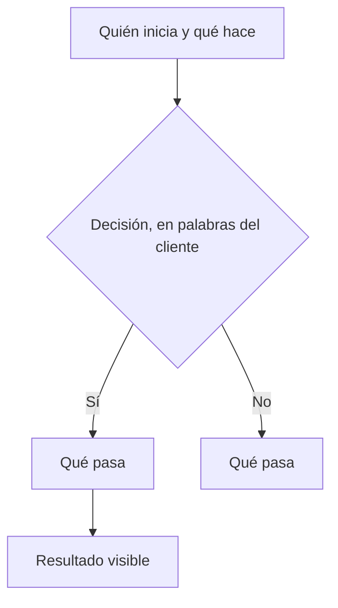

# Contrato de negocio — [Proyecto]

<!-- Solo si se reconstruyó o faltan fuentes; si no, borrar este bloque:
> **Aviso:** reconstruido a partir de [código / carpeta]. Sin registro de reuniones anteriores a [fecha].
> Lo marcado "A confirmar" todavía no fue validado con el cliente.
-->

## 1. En dos minutos

**Problema que resolvemos:** [Una frase, sobre el negocio.]

**Qué va a notar el cliente:**
- **[Resultado 1]:** [en lenguaje llano]
- **[Resultado 2]:** [...]
- **[Resultado 3]:** [...]

**Fuera de alcance:**
- [Cosa conversada que no entra] — [motivo breve]

**Preguntas abiertas:**
- **P-01:** [Decisión que falta] — responde: [quién] — frena: [REQ o RN que depende de esto]

## 2. Cómo funciona

## 3. Reglas del negocio

| ID | Regla | Estado | Fuente |
|---|---|---|---|
| RN-01 | Cuando [situación], [qué pasa]. | Acordada | [archivo · fecha o minuto · «cita breve»] |
| RN-02 | [Quién] puede / no puede [qué], [límite concreto]. | A confirmar | equipo |

## 4. Requisitos

| ID | Requisito | Estado | Cambio | Listo cuando | Reglas | Fuente |
|---|---|---|---|---|---|---|
| REQ-01 | [Qué necesita el negocio] | Acordado | Nuevo | [Condición que cualquiera puede comprobar] | RN-01 | [archivo · fecha o minuto] |

## 5. Cambios

### v1 — [AAAA-MM-DD] — [reunión inicial / adopción]
- Versión inicial.

## 6. Fuentes

- [ruta/] — [qué contiene]
- Externo (no leído por el agente): [Drive, mails, audios sin transcribir…]

## 7. Para quien construye

- Este contrato define el alcance. No se construye nada de "Fuera de alcance" ni lo que esté "A confirmar" o "Descartado".
- Antes de construir un requisito, leé la fuente original que indica su columna Fuente: acá está el resumen, allá el detalle.
- Cada "Listo cuando" y cada regla (RN) asociada al requisito se convierte en una verificación o prueba.
- Si la fuente original contradice una regla o un "Listo cuando", frená y preguntá antes de seguir.
- Si el estado del contrato es `borrador`, pedí confirmación antes de construir.
- No edites este archivo al construir. Los cambios de alcance entran por BCDD.
