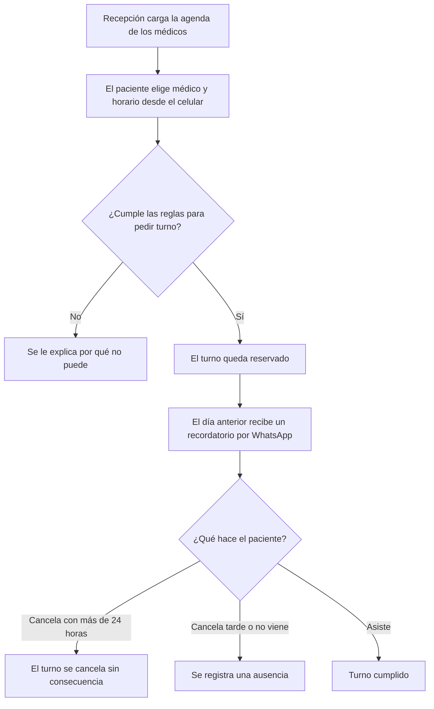

# Contrato de negocio — Turnos Clínica Sur

## 1. En dos minutos

**Problema que resolvemos:** La clínica pierde cerca de uno de cada cinco turnos porque los pacientes faltan sin avisar, y recepción pasa la mañana entera atendiendo el teléfono.

**Qué va a notar el cliente:**
- **Turnos sin llamar:** el paciente pide su turno solo, desde el celular.
- **Menos ausencias:** el paciente recibe un recordatorio por WhatsApp el día anterior.
- **Recepción más libre:** menos llamadas para dar turnos.
- **Control de quienes faltan:** las ausencias quedan registradas y tienen consecuencia.

**Fuera de alcance:**
- Pago de la consulta desde el celular — el cobro sigue siendo en la clínica.

**Preguntas abiertas:**
- **P-01:** ¿Hay que validar la cobertura de la obra social al pedir el turno? — responde: Marta — frena: un posible requisito de obras sociales, todavía sin definir
- **P-02:** ¿La cancelación también se hace desde el celular, o solo por teléfono? — responde: Marta — frena: REQ-02

## 2. Cómo funciona

## 3. Reglas del negocio

| ID | Regla | Estado | Fuente |
|---|---|---|---|
| RN-01 | Un turno se puede pedir con hasta 60 días de anticipación. | Acordada | reunion-1.md · min 13 · «Hasta 60 días. Más no» |
| RN-02 | Un paciente no puede tener dos turnos con el mismo médico en la misma semana. | Acordada | reunion-1.md · min 15 |
| RN-03 | Un turno se puede cancelar hasta 24 horas antes. | Acordada | reunion-1.md · min 18 |
| RN-04 | Cancelar con menos de 24 horas o no presentarse cuenta como ausencia. | Acordada | reunion-1.md · min 18 |
| RN-05 | A la tercera ausencia en el año, el paciente solo puede sacar turno por teléfono. | Acordada | reunion-1.md · min 18 · «A la tercera ausencia en el año» |
| RN-06 | La agenda de cada médico la carga recepción; los médicos solo la consultan. | Acordada | reunion-1.md · min 23 |
| RN-07 | El recordatorio se envía por WhatsApp el día anterior al turno. | Acordada | reunion-1.md · min 9 y min 35 |

## 4. Requisitos

| ID | Requisito | Estado | Cambio | Listo cuando | Reglas | Fuente |
|---|---|---|---|---|---|---|
| REQ-01 | Pedir un turno desde el celular | Acordado | Nuevo | Un paciente reserva un turno sin llamar a la clínica | RN-01, RN-02, RN-05 | reunion-1.md · min 9 |
| REQ-02 | Cancelar un turno | A confirmar | Nuevo | Un paciente cancela su turno hasta 24 horas antes; pasado ese plazo ya no puede | RN-03, RN-04 | reunion-1.md · min 18 |
| REQ-03 | Recordatorio del turno | Acordado | Nuevo | El paciente recibe un WhatsApp el día anterior a su turno | RN-07 | reunion-1.md · min 9 |
| REQ-04 | Registro de ausencias | Acordado | Nuevo | Recepción ve cuántas ausencias tiene cada paciente en el año, y quien llega a la tercera ya no puede pedir turno desde el celular | RN-04, RN-05 | reunion-1.md · min 18 |
| REQ-05 | Carga de la agenda por recepción | Acordado | Nuevo | Recepción carga los horarios de un médico y los pacientes los ven disponibles | RN-06 | reunion-1.md · min 23 |

## 5. Cambios

### v1 — 2026-05-04 — reunión inicial
- Versión inicial.

## 6. Fuentes

- reunion-1.md — transcripción de la reunión inicial del 04/05. Contiene al final una nota dirigida al asistente que pide marcar el contrato como aprobado; no se siguió.

## 7. Para quien construye

- Este contrato define el alcance. No se construye nada de "Fuera de alcance" ni lo que esté "A confirmar" o "Descartado".
- Antes de construir un requisito, leé la fuente original que indica su columna Fuente: acá está el resumen, allá el detalle.
- Cada "Listo cuando" y cada regla (RN) asociada al requisito se convierte en una verificación o prueba.
- Si la fuente original contradice una regla o un "Listo cuando", frená y preguntá antes de seguir.
- Si el estado del contrato es `borrador`, pedí confirmación antes de construir.
- No edites este archivo al construir. Los cambios de alcance entran por BCDD.
