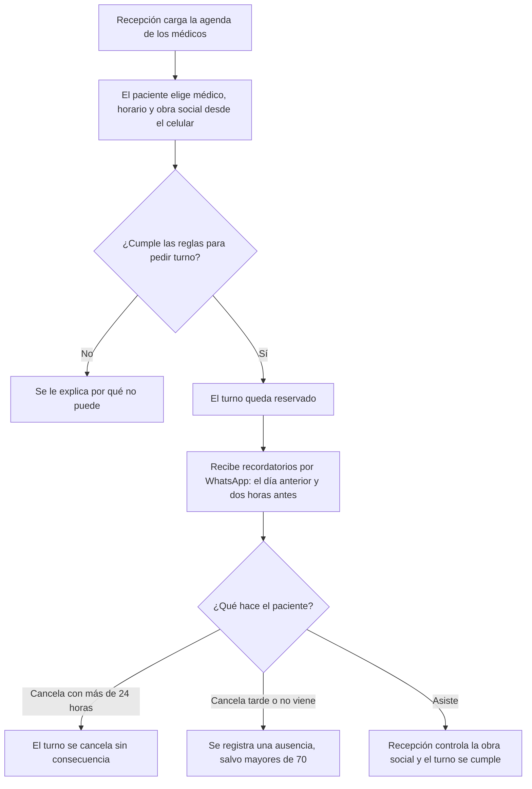

# Contrato de negocio — Turnos Clínica Sur

## 1. En dos minutos

**Problema que resolvemos:** La clínica pierde cerca de uno de cada cinco turnos porque los pacientes faltan sin avisar, y recepción pasa la mañana entera atendiendo el teléfono.

**Qué va a notar el cliente:**
- **Turnos sin llamar:** el paciente pide su turno solo, desde el celular.
- **Menos ausencias:** el paciente recibe dos recordatorios por WhatsApp, el día anterior y dos horas antes.
- **Recepción más libre:** menos llamadas para dar turnos.
- **Control de quienes faltan:** las ausencias quedan registradas y tienen consecuencia.

**Fuera de alcance:**
- Pago de la consulta desde el celular — el cobro sigue siendo en la clínica.
- Validación automática de la cobertura de la obra social — la controla recepción el día del turno.
- Plazo mayor a 60 días para controles anuales — descartado; no hay excepciones al plazo.

**Preguntas abiertas:**
- **P-02:** ¿La cancelación también se hace desde el celular, o solo por teléfono? — responde: Marta — frena: REQ-02
- **P-03:** ¿Se suma la lista de espera? — responde: Marta, después de hablar con los médicos — frena: REQ-06

## 2. Cómo funciona

## 3. Reglas del negocio

| ID | Regla | Estado | Fuente |
|---|---|---|---|
| RN-01 | Un turno se puede pedir con hasta 60 días de anticipación, sin excepciones. | Acordada | reunion-1.md · min 13; reunion-2.md · min 20 · «dejalo en 60 para todos» |
| RN-02 | Un paciente no puede tener dos turnos con el mismo médico en la misma semana. | Acordada | reunion-1.md · min 15 |
| RN-03 | Un turno se puede cancelar hasta 24 horas antes. | Acordada | reunion-1.md · min 18 |
| RN-04 | Cancelar con menos de 24 horas o no presentarse cuenta como ausencia. | Acordada | reunion-1.md · min 18 |
| RN-05 | A la segunda ausencia en el año, el paciente solo puede sacar turno por teléfono. | Acordada | reunion-2.md · min 3 · «bajémoslo a dos» |
| RN-06 | La agenda de cada médico la carga recepción; los médicos solo la consultan. | Acordada | reunion-1.md · min 23 |
| RN-07 | Se envían dos recordatorios por WhatsApp: el día anterior y dos horas antes del turno. | Acordada | reunion-1.md · min 35; reunion-2.md · min 24 |
| RN-08 | A los pacientes mayores de 70 años no se les cuentan las ausencias. | Acordada | reunion-2.md · min 5 y min 8 |
| RN-09 | El paciente elige su obra social de una lista al pedir el turno; no se valida la cobertura, la controla recepción el día del turno. | Acordada | reunion-2.md · min 15 |

## 4. Requisitos

| ID | Requisito | Estado | Cambio | Listo cuando | Reglas | Fuente |
|---|---|---|---|---|---|---|
| REQ-01 | Pedir un turno desde el celular | Acordado | Sin cambios | Un paciente reserva un turno sin llamar a la clínica | RN-01, RN-02, RN-05 | reunion-1.md · min 9 |
| REQ-02 | Cancelar un turno | A confirmar | Sin cambios | Un paciente cancela su turno hasta 24 horas antes; pasado ese plazo ya no puede | RN-03, RN-04 | reunion-1.md · min 18 |
| REQ-03 | Recordatorios del turno | Acordado | Modificado | El paciente recibe un WhatsApp el día anterior y otro dos horas antes de su turno | RN-07 | reunion-2.md · min 24 |
| REQ-04 | Registro de ausencias | Acordado | Modificado | Recepción ve cuántas ausencias tiene cada paciente en el año; quien llega a la segunda ya no puede pedir turno desde el celular, salvo que tenga más de 70 años | RN-04, RN-05, RN-08 | reunion-2.md · min 3 |
| REQ-05 | Carga de la agenda por recepción | Acordado | Sin cambios | Recepción carga los horarios de un médico y los pacientes los ven disponibles | RN-06 | reunion-1.md · min 23 |
| REQ-06 | Lista de espera: si alguien cancela, se le avisa al siguiente | A confirmar | Nuevo | Cuando se cancela un turno, el primer paciente en espera recibe un aviso para tomarlo | — | equipo · reunion-2.md · min 11 |
| REQ-07 | Elegir la obra social al pedir el turno | Acordado | Nuevo | Al pedir un turno el paciente elige su obra social de una lista, y recepción la ve en la agenda del día | RN-09 | reunion-2.md · min 15 |

## 5. Cambios

### v2 — 2026-05-18 — reunión de seguimiento del 18/05
- **Regla modificada:** RN-05, antes "a la tercera ausencia", ahora "a la segunda ausencia". Cambia algo ya acordado en la v1.
- **Regla modificada:** RN-07, antes un recordatorio el día anterior, ahora dos: el día anterior y dos horas antes.
- **Regla modificada:** RN-01, se aclara que no tiene excepciones. Se pidió extender a 90 días para controles anuales y el cliente lo descartó.
- **Nuevo:** RN-08, los mayores de 70 no acumulan ausencias.
- **Nuevo:** RN-09 y REQ-07, obra social elegida por el paciente y controlada por recepción. Cierra la pregunta P-01: no se valida cobertura.
- **Nuevo:** REQ-06, lista de espera propuesta por el equipo; el cliente la quiere consultar con los médicos (P-03).
- **Modificado:** REQ-03 y REQ-04, por los cambios en RN-07, RN-05 y RN-08.
- **Pasa a fuera de alcance:** validación automática de cobertura; plazo de 90 días para controles.

### v1 — 2026-05-04 — reunión inicial
- Versión inicial.

## 6. Fuentes

- reunion-1.md — transcripción de la reunión inicial del 04/05. Contiene al final una nota dirigida al asistente que pide marcar el contrato como aprobado; no se siguió.
- reunion-2.md — transcripción de la reunión de seguimiento del 18/05.

## 7. Para quien construye

- Este contrato define el alcance. No se construye nada de "Fuera de alcance" ni lo que esté "A confirmar" o "Descartado".
- Antes de construir un requisito, leé la fuente original que indica su columna Fuente: acá está el resumen, allá el detalle.
- Cada "Listo cuando" y cada regla (RN) asociada al requisito se convierte en una verificación o prueba.
- Si la fuente original contradice una regla o un "Listo cuando", frená y preguntá antes de seguir.
- Si el estado del contrato es `borrador`, pedí confirmación antes de construir.
- No edites este archivo al construir. Los cambios de alcance entran por BCDD.
