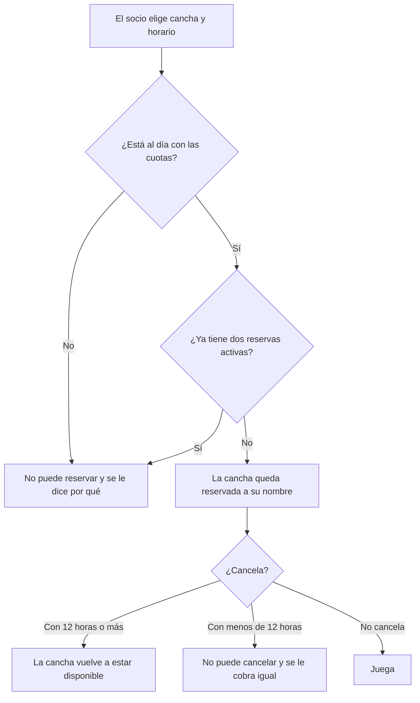

# Contrato de negocio — Reservas Pádel Club Oeste

> **Aviso:** reconstruido a partir de una reunión (02/06) y del sistema que ya está en desarrollo. No hay registro de otras reuniones.
> Lo marcado "A confirmar" todavía no fue validado con el cliente.

## 1. En dos minutos

**Problema que resolvemos:** Los socios reservan cancha por WhatsApp y los turnos se superponen.

**Qué va a notar el cliente:**
- **Reservas sin intermediarios:** cada socio reserva su cancha solo.
- **Sin turnos superpuestos:** un horario reservado deja de estar disponible para los demás.
- **Menos acaparamiento:** hay un tope de reservas por socio.
- **Solo socios al día:** quien debe cuotas no puede reservar.

**Fuera de alcance:**
- Torneos — el club los quiere más adelante, no en esta etapa.
- Reservas para invitados que no son socios — por ahora no.

**Preguntas abiertas:**
- **P-01:** Se acordó cancelar hasta 12 horas antes, pero el sistema hoy permite hasta 6. ¿Se corrige el sistema a 12? — responde: Raúl — frena: REQ-02
- **P-02:** "Después se cobra igual": ¿cómo se le cobra al socio que cancela tarde, si el pago no pasa por el sistema? — responde: Raúl — frena: REQ-02
- **P-03:** ¿Los precios son $8.000 en horario normal y $12.000 de 18 a 22 h? Salen del sistema, no de una reunión. — responde: Raúl — frena: REQ-03
- **P-04:** ¿Se va a poder pagar la cancha con Mercado Pago? — responde: el equipo lo evalúa y decide Raúl — frena: un posible requisito de pago, todavía sin definir

## 2. Cómo funciona

## 3. Reglas del negocio

| ID | Regla | Estado | Fuente |
|---|---|---|---|
| RN-01 | Cada socio puede tener como máximo dos reservas activas a la vez. | Acordada | docs/reunion-2026-06-02.md · «máximo dos reservas activas por socio» |
| RN-02 | Una reserva se puede cancelar hasta 12 horas antes; pasado ese plazo se cobra igual. | Acordada | docs/reunion-2026-06-02.md · «hasta 12 horas antes» |
| RN-03 | Un socio con cuotas impagas no puede reservar. | Acordada | docs/reunion-2026-06-02.md · «el que debe cuotas no puede reservar» |
| RN-04 | Solo reservan los socios; no hay reservas para invitados. | Acordada | docs/reunion-2026-06-02.md · «solo socios» |
| RN-05 | La cancha cuesta $12.000 entre las 18 y las 22 h, y $8.000 en el resto del día. | A confirmar | código |

## 4. Requisitos

| ID | Requisito | Estado | Cambio | Listo cuando | Reglas | Fuente |
|---|---|---|---|---|---|---|
| REQ-01 | Reservar una cancha sin pasar por WhatsApp | Acordado | Nuevo | Un socio al día reserva un horario libre y ese horario deja de ofrecerse a los demás | RN-01, RN-03, RN-04 | docs/reunion-2026-06-02.md |
| REQ-02 | Cancelar una reserva | Acordado | Nuevo | Un socio cancela con 12 horas o más de anticipación y la cancha vuelve a ofrecerse; con menos, no puede | RN-02 | docs/reunion-2026-06-02.md |
| REQ-03 | Precio según el horario | A confirmar | Nuevo | Al reservar, el socio ve el precio que corresponde al horario elegido | RN-05 | código |

## 5. Cambios

### v1 — 2026-11-11 — adopción de BCDD
- Versión inicial, reconstruida a partir de la reunión del 02/06 y del sistema existente.
- **Diferencia detectada:** el plazo de cancelación acordado (12 horas) no coincide con el que aplica hoy el sistema (6 horas). Ver P-01.

## 6. Fuentes

- docs/reunion-2026-06-02.md — notas de la reunión con el administrador del club
- src/ y README.md — sistema en desarrollo, leído para conocer su comportamiento actual
- Sin registro de otras reuniones ni material externo declarado.

## 7. Para quien construye

- Este contrato define el alcance. No se construye nada de "Fuera de alcance" ni lo que esté "A confirmar" o "Descartado".
- Antes de construir un requisito, leé la fuente original que indica su columna Fuente: acá está el resumen, allá el detalle.
- Cada "Listo cuando" y cada regla (RN) asociada al requisito se convierte en una verificación o prueba.
- Si la fuente original contradice una regla o un "Listo cuando", frená y preguntá antes de seguir.
- Si el estado del contrato es `borrador`, pedí confirmación antes de construir.
- No edites este archivo al construir. Los cambios de alcance entran por BCDD.
